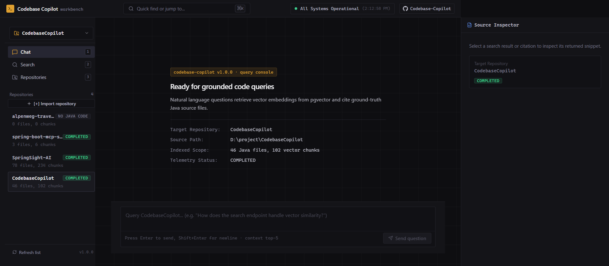
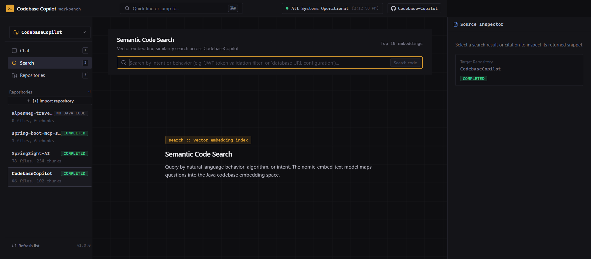
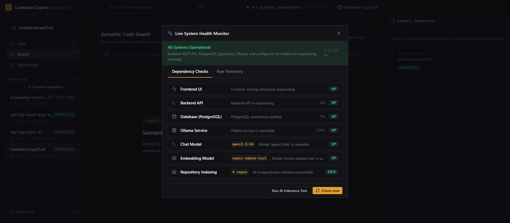
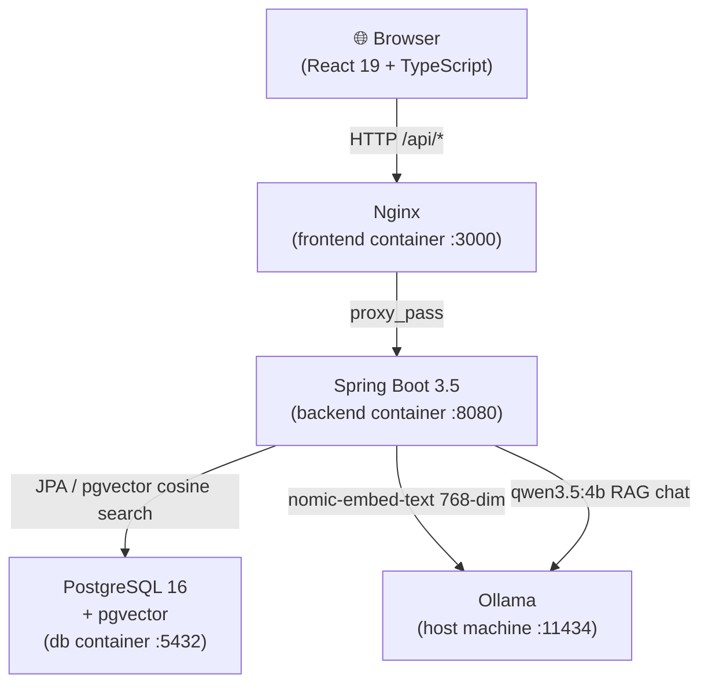
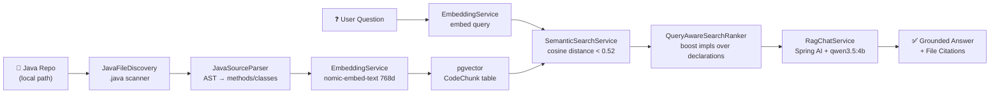
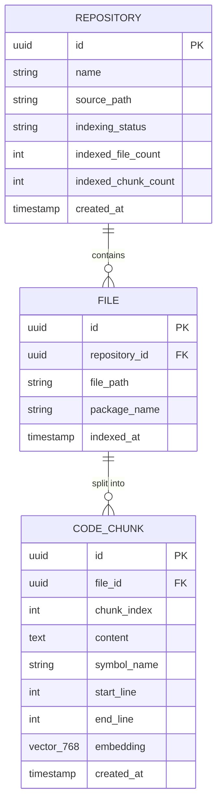

<div align="center">

# 🔍 Codebase Copilot

**A developer workbench for understanding Java codebases using natural language.**  
Ask questions, get cited answers grounded in your actual source code.

[](https://codebase-copilot-app.onrender.com/)
[](https://codebase-copilot-api-r584.onrender.com/api/health)
[](https://spring.io/projects/spring-boot)
[](https://spring.io/projects/spring-ai)
[](https://react.dev/)
[](https://www.typescriptlang.org/)
[](https://github.com/pgvector/pgvector)
[](https://ollama.com/)
[](https://openjdk.org/)
[](LICENSE)

</div>

---

## 📸 Screenshots

<table>
  <tr>
    <td align="center">
      <strong>Chat — RAG Query Console</strong><br/>
      
    </td>
    <td align="center">
      <strong>Repositories — Indexed Workspaces</strong><br/>
      
    </td>
  </tr>
  <tr>
    <td align="center">
      <strong>Semantic Search with Source Citations</strong><br/>
      
    </td>
    <td align="center">
      <strong>Live System Health Monitor</strong><br/>
      
    </td>
  </tr>
</table>

---

## ✨ Features

- **RAG Chat** — Ask natural language questions about any indexed Java codebase; get grounded answers with file + line citations
- **Semantic Search** — Vector similarity search over code chunks (cosine distance via pgvector)
- **Multi-repo support** — Index and switch between multiple Java projects
- **Source Inspector** — Click any citation to view the exact code snippet inline
- **Command Palette** — `Ctrl+K` global quick-find across all views
- **System Health Monitor** — Real-time status of all components (DB, Ollama, chat model, embeddings)
- **Fully local LLM** — 100% private; no data leaves your machine (Ollama)
- **Console-style dark UI** — Hallmark-compliant, zero glassmorphism, developer-first aesthetic

---

## 🏗️ Architecture



### RAG Pipeline



### Data Model



---

## 🛠️ Tech Stack

| Layer | Technology |
|-------|-----------|
| **Backend** | Spring Boot 3.5.16, Spring AI 1.1.8, Spring Data JPA |
| **AI / LLM** | Ollama — `qwen3.5:4b` (chat), `nomic-embed-text` (768-dim embeddings) |
| **Database** | PostgreSQL 16 + pgvector extension |
| **Frontend** | React 19, TypeScript 5.8, Vite 6, Lucide icons |
| **Infra** | Docker Compose (3-container), Nginx reverse proxy |
| **Testing** | Vitest (8 unit tests), Spring Boot Test (12 unit/integration tests) |
| **CI/Deploy** | Render (frontend + backend), Cloudflare Tunnel (Ollama bridge) |

---

## 🚀 Quick Start (Docker)

### Prerequisites

- [Docker Desktop](https://www.docker.com/products/docker-desktop/) (Linux container mode)
- [Ollama](https://ollama.com/) installed and running (`localhost:11434`)
- Git

### 1. Pull Ollama models

```bash
ollama pull qwen3.5:4b
ollama pull nomic-embed-text
```

> `qwen3.5:4b` needs ~4 GB RAM. Cold-start: ~60–340 s on CPU. Warm queries: ~10–25 s.

### 2. Clone & configure

```bash
git clone https://github.com/aldehydeketone/Codebase-Copilot.git
cd Codebase-Copilot
cp .env.example .env
# Edit .env — set COPILOT_DB_PASSWORD to anything strong
```

### 3. Start all services

```bash
docker compose up -d
docker compose ps    # all 3 containers should be healthy
```

| Container | Port | Purpose |
|-----------|------|---------|
| `codebase-copilot-db` | `127.0.0.1:5433` | PostgreSQL 16 + pgvector |
| `codebase-copilot-backend` | `127.0.0.1:8080` | Spring Boot API |
| `codebase-copilot-frontend` | `127.0.0.1:3000` | React UI (Nginx) |

### 4. Open the app

Navigate to **http://localhost:3000** and click **[+ Import repository]** to index a Java project by its absolute path.

---

## 💻 Local Development (no Docker for backend/frontend)

> Requirements: Java 21, Maven 3.9+, Node.js 20+, Docker (for DB only)

```bash
# 1. Start only the database
docker compose up -d db

# 2. Run backend
mvn spring-boot:run

# 3. Run frontend dev server (separate terminal)
cd frontend
npm ci
npm run dev
# → http://localhost:5173 (Vite proxies /api → :8080)
```

---

## 🔌 API Reference

### Health check
```bash
GET /api/health
```
```json
{
  "status": "OPERATIONAL",
  "checks": {
    "ollama": { "status": "UP", "latencyMs": 263 },
    "chatModel": { "status": "UP", "model": "qwen3.5:4b" },
    "embeddingModel": { "status": "UP", "model": "nomic-embed-text" },
    "database": { "status": "UP", "latencyMs": 7 }
  }
}
```

### Import a repository
```bash
POST /api/repositories/import
Content-Type: application/json

{ "path": "/absolute/path/to/java-project", "name": "my-project" }
```

### Semantic search
```bash
POST /api/search
Content-Type: application/json

{ "query": "Where is the order total calculated?", "repositoryId": "<uuid>", "limit": 5 }
```

### RAG chat
```bash
POST /api/chat
Content-Type: application/json

{ "question": "How does authentication work?", "repositoryId": "<uuid>", "topK": 5 }
```

Response includes `answer` (Markdown string) and `citations` (file path + line ranges + snippet).

---

## 🧪 Tests

```bash
# Frontend — 8 unit tests
cd frontend && npm test

# Backend — unit tests (H2 in-memory, no external services)
mvn clean verify

# Backend — full pipeline integration test (needs live PostgreSQL + Ollama)
mvn -Dtest=RealPipelineIntegrationTest -DrealIntegration=true test

# Frontend production build
cd frontend && npm run build
```

---

## ⚙️ Environment Variables

| Variable | Default | Description |
|----------|---------|-------------|
| `COPILOT_DB_HOST` | `127.0.0.1` | PostgreSQL host |
| `COPILOT_DB_PORT` | `5433` | PostgreSQL port |
| `COPILOT_DB_NAME` | `copilot_db` | Database name |
| `COPILOT_DB_USER` | `copilot_user` | Database user |
| `COPILOT_DB_PASSWORD` | *(required)* | Database password |
| `OLLAMA_BASE_URL` | `http://localhost:11434` | Ollama endpoint |
| `OLLAMA_CHAT_MODEL` | `qwen3.5:4b` | Chat LLM model |
| `OLLAMA_EMBED_MODEL` | `nomic-embed-text` | Embedding model (768-dim) |
| `OLLAMA_CHAT_KEEP_ALIVE` | `10m` | Keep model loaded in RAM |
| `OLLAMA_CHAT_READ_TIMEOUT` | `420s` | HTTP read timeout for chat |
| `BACKEND_EXTERNAL_PORT` | `8080` | Host port for backend |
| `FRONTEND_EXTERNAL_PORT` | `3000` | Host port for frontend |

---

## 🗃️ Docker Operations

```bash
# Stop (preserve data volumes)
docker compose stop

# Resume
docker compose start

# Remove containers but keep DB data
docker compose down

# ⚠️ WARNING — this DELETES the database permanently
# docker compose down -v

# Rebuild a single image
docker compose build backend

# Database backup
docker compose exec db pg_dump -U copilot_user copilot_db > backup_$(date +%Y%m%d).sql
```

---

## 📂 Project Structure

```
CodebaseCopilot/
├── src/main/java/com/copilot/
│   ├── controller/          # REST endpoints (Chat, Search, Repository, Health)
│   ├── service/
│   │   ├── ingestion/       # JavaFileDiscovery, JavaSourceParser, RepositoryIndexer
│   │   ├── embedding/       # EmbeddingService (nomic-embed-text)
│   │   ├── search/          # SemanticSearchService, QueryAwareSearchRanker
│   │   └── rag/             # RagChatService (Spring AI + Ollama)
│   ├── model/               # JPA entities (Repository, File, CodeChunk)
│   └── config/              # CORS, Ollama client, filters
├── frontend/
│   ├── src/
│   │   ├── components/      # ChatPanel, SearchPanel, RepositoryPanel, Sidebar…
│   │   ├── services/        # api.ts (typed HTTP client)
│   │   └── design.css       # Console theme (Hallmark-compliant, 0 FAIL)
│   └── vite.config.ts
├── docs/screenshots/        # UI screenshots
├── docker-compose.yml
├── Dockerfile
└── pom.xml
```

---

## 🔒 Privacy

All LLM inference runs locally via Ollama. **No code, queries, or answers are sent to any external API.** The only network calls are:
- pgvector queries (local Docker container)
- Ollama HTTP calls (`localhost:11434`)

When deployed to Render, a Cloudflare Tunnel bridges the Render backend to your local Ollama instance.

---

## 📄 License

MIT © [aldehydeketone](https://github.com/aldehydeketone)
